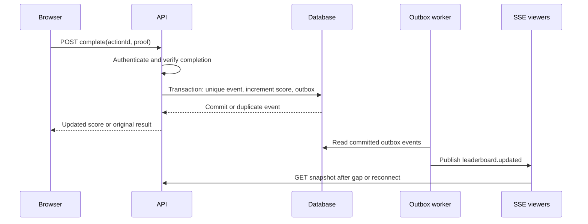

# Problem 6 — Live scoreboard module specification

## Scope and assumptions

This is an API service module specification for a backend team to implement. The website displays the ten highest user scores and updates while viewers are connected. A separate, trusted action workflow decides whether a user completed a score-bearing action and how many points that action earns. The browser is never authoritative for points, user identity, or completion. The same action must award points at most once. An authenticated user can act; anyone allowed to view the site can read the leaderboard (change this read policy if product requirements differ).

## API contract

| Endpoint | Purpose |
| --- | --- |
| `POST /v1/actions/:actionId/complete` | Authenticated completion request. The body contains only action-specific proof, if needed; **no points or userId**. Returns `200 { eventId, score, awardedPoints }` on first success. Retrying the same completed action returns the stored result without awarding again. |
| `GET /v1/leaderboard?limit=10` | Snapshot `{ version, leaders: [{ userId, displayName, score, rank }] }`. Initially cap `limit` at 10. |
| `GET /v1/leaderboard/events` | Server-Sent Events stream of `leaderboard.updated` snapshots with event IDs. Send a current snapshot on connect, then new versions and heartbeat comments. Client reconnects automatically and refetches a snapshot after a gap. |

Use the existing authentication/session mechanism. Return 401 for no session, 403 when the action belongs to another user or is ineligible, 404 for an unknown action, 422 for proof that cannot establish completion, and 429 for rate-limited requests. Error bodies follow `{ error: { code, message } }`. Exact action proof is an integration point; the action owner must specify verifiable server-side evidence, such as its own completion record or a signed event from a trusted service. A client-created boolean or arbitrary signature obtained solely by clicking a button is insufficient.

## Storage and transaction

Relational tables (PostgreSQL is one possible implementation):

- `users(id, display_name, score, ...)`, with `score` initialized to zero and constrained nonnegative.
- `actions(id, user_id, type, status, completed_at, ...)`, or a trusted external action lookup. Eligibility and fixed awarded points come from server-side action rules.
- `score_events(id, user_id, action_id UNIQUE, delta, new_score, created_at)`. The unique action ID enforces at-most-once awards across retries and simultaneous requests.
- `outbox(id, score_event_id UNIQUE, payload, published_at)` for reliable publication after the database commit.

Within **one database transaction**: check the authenticated user's ownership and completed action state; insert a score event with a unique `action_id`; atomically update the user's score; insert an outbox event; commit. If the unique insert conflicts, read and return the original score event. Do not publish or return success before committing. Define whether an action can ever be revoked or its score corrected; if so, use compensating events rather than rewriting the event history.

Read the top ten with `ORDER BY score DESC, id ASC LIMIT 10`. The user ID gives deterministic ordering for ties; displayed rank can use competition ranking (e.g., 1, 2, 2, 4) if product chooses it. Index `(score DESC, id ASC)`. Do not expose private profile fields.

## Flow of execution

The worker computes a fresh top-ten snapshot after a committed score event, publishes a monotonically increasing version, and marks the outbox row delivered. Delivery may be repeated after a crash, so clients ignore versions they have already applied. If there are multiple API instances, send events via a shared broker or pub/sub; an in-process emitter alone would miss viewers connected to other instances. The database remains the source of truth.

## Abuse resistance and reliability

1. Verify session identity and action ownership on the server. Never accept `score`, `delta`, or a user ID from the request as authorization.
2. Establish completion from trusted server-side state, reject replay with the unique action ID, and apply per-user/IP rate limits. Logs should record accepted and denied attempts without sensitive proof data.
3. Use parameterized queries and least-privilege database credentials. Apply normal CSRF protection if browser cookie authentication is used; require HTTPS.
4. SSE sends a snapshot on connection and heartbeats to detect dead connections. After a reconnect or missed version, fetch `GET /v1/leaderboard`; eventual update delay does not change committed scores.
5. Monitor validation failures, duplicate awards, outbox lag, connection count and leaderboard latency. Test parallel completion requests for one action, replay, forged user/points, tie ordering, reconnect, and worker crash after publish.

## Growth path

Start with the indexed relational query for ten rows; its simplicity makes correctness easy to audit. If reads or broadcasts become expensive, keep a Redis sorted-set projection for top-ten reads, rebuilt from the database after an outage. Publish from the durable outbox to a shared broker and fan out to SSE instances. The projection and stream may lag briefly; the committed database record remains authoritative. Restrict subscription count and heartbeat frequency based on load measurements.
